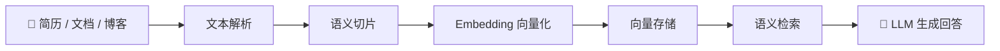
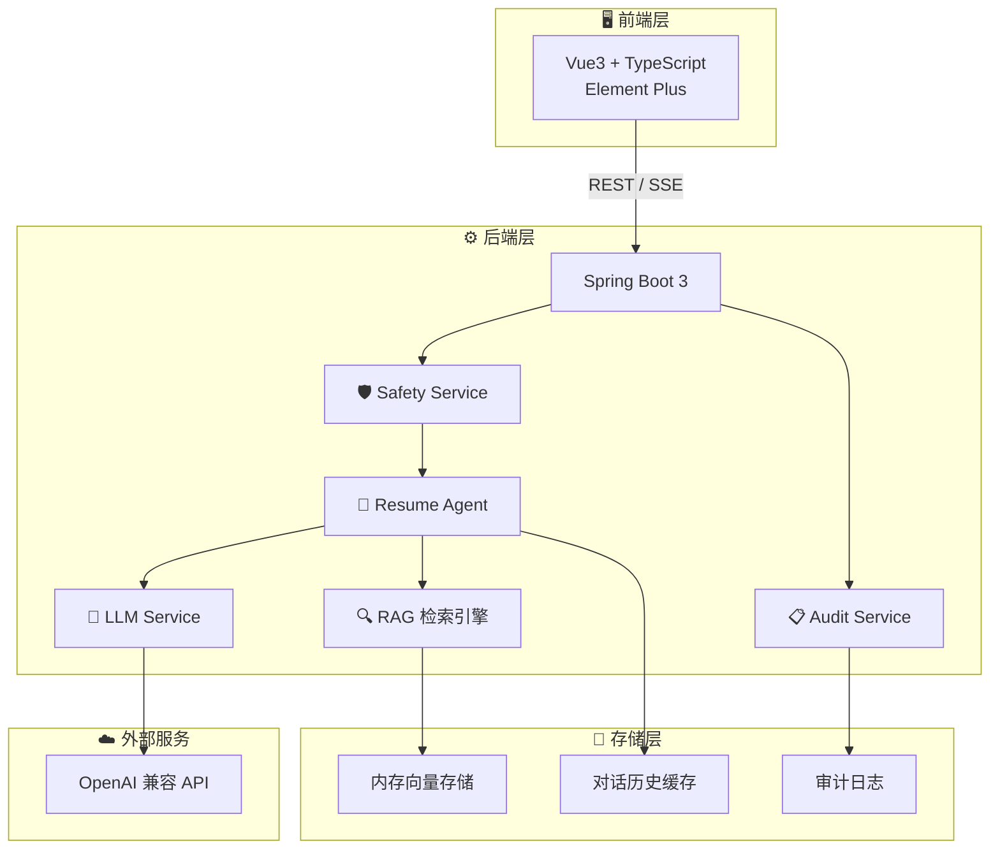

<div align="center">

# 🤖 ResumeAgent

### 基于 RAG 的个人简历智能 Agent 系统

**让 AI 成为你的"数字分身"，精准回答关于你的一切**

[](https://www.oracle.com/java/)
[](https://spring.io/projects/spring-boot)
[](https://vuejs.org/)
[](https://www.typescriptlang.org/)
[](#)

<br/>

<p>
<strong>模拟面试</strong> · <strong>RAG 知识库</strong> · <strong>岗位匹配</strong> · <strong>技能分析</strong> · <strong>面试助手</strong> · <strong>安全防护</strong>
</p>

</div>

---

## 📖 目录

- [项目简介](#-项目简介)
- [解决什么问题](#-解决什么问题)
- [核心功能](#-核心功能)
  - [模拟面试](#-模拟面试)
  - [RAG 知识库](#-rag-知识库)
  - [Agent 智能分析](#-agent-智能分析)
  - [安全机制](#-安全机制)
  - [SSE 流式对话](#-sse-流式对话)
  - [前端界面](#-前端界面)
- [系统架构](#-系统架构)
- [数据处理流程](#-数据处理流程)
- [模块详解](#-模块详解)
- [API 接口文档](#-api-接口文档)
- [技术栈](#-技术栈)
- [快速开始](#-快速开始)
- [配置说明](#-配置说明)
- [项目结构](#-项目结构)
- [开发计划](#-开发计划)
- [项目亮点](#-项目亮点)
- [简历描述](#-简历描述可直接使用)

---

## ✨ 项目简介

ResumeAgent 是一个基于 **Spring Boot 3 + Vue3 + RAG + Agent** 构建的个人 AI 简历助手系统。

系统将你的简历、项目文档、技术博客、GitHub 项目说明等个人资料导入知识库，通过 **RAG（检索增强生成）** 技术检索相关上下文，结合 LLM 生成**准确、可追溯**的回答。所有个人数据均从知识库动态检索，**零硬编码**，确保回答始终基于最新资料。同时内置 Agent 能力，支持岗位匹配分析、技能图谱总结、面试回答生成等高级功能。

> 🎯 **适用场景**：求职面试准备、个人技术品牌展示、项目经历梳理、能力盘点与职业规划。


---

## ❓ 解决什么问题

| 痛点 | ResumeAgent 的方案 |
|:---|:---|
| 大模型不了解你的个人经历 | RAG 知识库动态注入个人资料，回答基于真实数据，无硬编码 |
| 面试前准备耗时，难以全面梳理 | Agent 基于知识库自动生成岗位匹配分析和面试回答 |
| 通用 AI 回答偏泛化、容易编造 | 检索增强 + 引用溯源，降低幻觉 |
| 个人敏感信息容易泄露 | Prompt Injection 检测 + PII 自动脱敏 |
| 缺少一个统一的"个人数字分身"入口 | 一个系统整合问答、分析、面试全流程 |

---

## 🎯 核心功能

### 💬 模拟面试

系统**以你的身份**回答面试官的问题，就像你本人在面试。支持**模拟面试**和**通用对话**两种模式，可随时切换。

**核心机制**：
- AI 不是"帮你介绍简历"，而是**就是你本人**
- 全程第一人称回答，语气自然口语化
- 基于知识库中的真实经历，不编造

**示例**：

```
面试官: "请介绍一下你自己"
面试官: "你做过哪些项目？"
面试官: "你在项目中遇到过什么难点？"
面试官: "你最擅长的技术是什么？"
```


回答包含引用来源，可追溯到原始文档片段。

### 🔍 RAG 知识库

将个人资料转换为向量知识库，实现语义级别的精准检索。

**支持的资料类型**：

| 类型 | 格式 | 内容 |
|:---|:---:|:---|
| 📄 简历 | PDF / Word / TXT | 个人基本信息、教育、经历 |
| 📁 项目文档 | Markdown / TXT | 项目架构、技术方案、成果 |
| 📝 技术博客 | Markdown / HTML / TXT | 技术文章、学习笔记 |
| 🐙 GitHub 说明 | Markdown | 项目 README、文档 |

**核心流程**：



**技术细节**：
- 文本切片：260 字符上限，40 字符重叠，保证上下文连贯
- 向量化：128 维哈希嵌入（开发阶段，可替换为真实 Embedding 模型）
- 检索策略：余弦相似度 + 词汇增强混合排序，兼顾语义和关键词匹配

### 🤖 Agent 智能分析

Agent 提供四类高级能力，不只是简单问答：

| 能力 | 说明 | 示例问题 |
|:---|:---|:---|
| 🎯 **岗位匹配** | 分析目标岗位与个人能力的匹配度、优势、短板 | "我适合 Java 安全开发岗位吗？" |
| 🔍 **项目查询** | 按项目名称、技术栈、时间线查询经历 | "我做过哪些 Spring Boot 项目？" |
| 📊 **技能分析** | 总结擅长方向、技术深度与覆盖面 | "帮我总结一下我的技术优势和短板" |
| 🎤 **面试回答** | 针对面试问题生成个性化回答 | "如果面试官问你项目难点，怎么回答？" |

### 🛡️ 安全机制

针对 Agent 场景设计的三层安全防护：

| 层级 | 功能 | 实现方式 |
|:---|:---|:---|
| 🛡️ **Prompt Injection 检测** | 识别恶意注入攻击 | 正则匹配中英文攻击模式（"忽略之前指令"、"泄露系统提示词"等） |
| 🔒 **PII 信息脱敏** | 保护个人敏感信息 | 自动识别并脱敏手机号、邮箱、身份证号 |
| 📋 **对话审计日志** | 全链路交互追踪 | 记录用户输入、检索片段、模型输出、工具调用 |

### 📡 SSE 流式对话

- 基于 `SseEmitter` 实现服务端推送
- 80ms 间隔逐行输出，前端打字机效果
- 支持中断和超时处理

### 🎨 前端界面

欢迎首页采用居中布局，两侧装饰面板展示系统能力信息，中间提供快速入口：

| 区域 | 内容 |
|:---|:---|
| 左侧面板 | 技术栈标签云、RAG 工作流步骤 |
| 中央 Hero | AI-Powered 徽章、产品标题、简介、技术名言 |
| 快速提问 | 编号提问卡片，点击直接发起对话 |
| 功能入口 | 2×2 网格卡片（岗位匹配/面试助手/技能分析/项目查询） |
| 右侧面板 | 核心指标（向量维度/分块上限/流式延迟）、支持格式 |
| 侧边栏底部 | 绿色状态灯，悬停显示 LLM 配置详情 |

聊天页支持 RAG / 通用对话双模式，输入区底部提供模式切换快捷键。

侧边栏底部的绿色状态指示灯支持悬停查看 LLM 配置详情：连接状态、模型名称、API 端点、密钥（脱敏）、温度和最大 Token 数。首次悬停时从后端获取数据，白色卡片风格与主页统一。

### 📖 使用指南

首次访问自动弹出模块化引导弹窗，帮助新用户快速了解系统功能：

| 步骤 | 内容 |
|:---|:---|
| 1. 欢迎 | 整体功能概览 |
| 2. 模拟面试 | 核心功能介绍（简历问答 / 通用对话） |
| 3. 岗位匹配 | 匹配度分析、优势、差距、建议 |
| 4. 面试助手 | STAR 法则回答生成 |
| 5. 技能分析 | 技术栈与能力图谱 |
| 6. 项目查询 | 关键词 / 技术栈检索项目 |
| 7. 开始使用 | 快速上手三步走 |

- 支持底部圆点跳转、上一步/下一步导航
- 侧边栏 `?` 按钮可随时重新打开
- 通过 `localStorage` 记录是否已查看

---

## 🏗️ 系统架构



**架构分层说明**：

| 层级 | 职责 | 关键组件 |
|:---|:---|:---|
| 前端层 | 交互展示、流式渲染、结果可视化 | Vue3、Element Plus、SSE 客户端 |
| 控制器层 | REST API 端点、请求路由 | ChatController、AgentController、RagController、SystemController |
| 服务层 | 核心业务逻辑、RAG 流水线编排 | ChatService、AgentService、KnowledgeBaseService |
| 安全层 | 注入检测、PII 脱敏、审计记录 | SafetyService、AuditService |
| 存储层 | 向量存储、对话缓存、日志持久化 | 内存存储（可扩展为 Milvus） |
| 外部层 | LLM 推理能力 | OpenAI 兼容 API |

---

## 📊 数据处理流程

### 问答流程（Chat）

```
用户输入
  │
  ▼
┌─────────────────────┐
│  SafetyService      │  ① 安全检查
│  - 注入检测          │     检测 Prompt Injection
│  - PII 脱敏          │     手机号/邮箱/身份证脱敏
└─────────┬───────────┘
          ▼
┌─────────────────────┐
│  KnowledgeBase      │  ② 知识检索
│  - 向量相似度        │     余弦相似度计算
│  - 词汇增强          │     关键词匹配加分
│  - 混合排序          │     综合评分 Top-K
└─────────┬───────────┘
          ▼
┌─────────────────────┐
│  PromptBuilder      │  ③ 提示词构建
│  - 动态系统提示词    │     角色设定 + RAG 上下文
│  - 对话历史          │     conversationId 关联
│  - 检索上下文        │     Top-K 片段作为背景知识
└─────────┬───────────┘
          ▼
┌─────────────────────┐
│  LlmService         │  ④ LLM 生成
│  - OpenAI 兼容 API   │     流式/普通模式
│  - 降级到模板回答     │     API 未配置时
└─────────┬───────────┘
          ▼
┌─────────────────────┐
│  AuditService       │  ⑤ 审计记录
│  - 记录完整交互      │     输入/输出/上下文
└─────────┬───────────┘
          ▼
       返回响应（含引用来源）
```

### 知识库入库流程

```
上传文件
  │
  ▼
文本解析（PDF/Word/Markdown/TXT）
  │
  ▼
文本清洗（去除噪音、规范化）
  │
  ▼
语义切片（260 字符上限，40 字符重叠）
  │
  ▼
Embedding 向量化（128 维哈希嵌入）
  │
  ▼
写入内存向量存储
```

---

## 🧩 模块详解

### 1. ChatService — 问答编排中心

ChatService 是整个系统的**中枢**，负责编排完整的 RAG 流水线：

- 维护基于 `conversationId` 的内存对话历史
- 调用 SafetyService 进行安全检查
- 调用 KnowledgeBaseService 检索相关知识
- 调用 PromptBuilder 构建完整提示词
- 调用 LlmService 生成回答
- 调用 AuditService 记录交互日志

### 2. KnowledgeBaseService — 知识库引擎

内存向量存储，核心能力：

- **文档入库**：解析 → 切片 → 向量化 → 存储
- **混合检索**：EmbeddingService 余弦相似度 + 词汇匹配增强
- **分块策略**：260 字符上限，40 字符重叠，保证语义连贯

### 3. EmbeddingService — 向量化引擎

基于哈希的嵌入实现（128 维），专为本地开发设计：

- 支持 CJK（中日韩）和 ASCII 分词
- 支持 n-gram 特征提取
- 无需外部 Embedding 服务，零依赖启动
- 可替换为真实模型（OpenAI Embedding、BGE 等）

### 4. LlmService — LLM 调用客户端

OpenAI 兼容 API 客户端：

- 支持任何 OpenAI 兼容接口（OpenAI、DeepSeek、通义千问、Ollama 等）
- 未配置时返回 `Optional.empty()`，触发 PromptBuilder 模板回答
- 可配置模型名称、温度、最大 token 数

### 5. AgentService — 智能分析引擎

完全基于 RAG 知识库的动态分析，无硬编码数据：

- **岗位匹配**：从知识库检索项目资料，提取技术关键词计算匹配度
- **项目查询**：从知识库检索并按来源分组，自动提取技术栈和项目亮点
- **技能分析**：基于知识库内容统计技能频次，生成能力图谱
- **面试回答**：从知识库检索相关项目，结合 STAR 法则生成个性化回答
- **LLM 增强**：配置 LLM 后可进行语义级别的深度分析
- **降级策略**：LLM 不可用时自动降级为基于知识库检索的模板回答

### 6. SafetyService — 安全防护

- **Prompt Injection 检测**：正则匹配中英文攻击模式
- **PII 脱敏**：自动识别手机号（11 位）、邮箱、身份证号（18 位）
- **可配置开关**：`block-on-injection` 和 `redact-sensitive` 独立控制

### 7. PromptBuilder — 提示词工程

为 LLM 构建结构化提示词，完全动态化：

- **动态系统提示词**：角色设定 + 回答风格指引 + RAG 检索结果注入
- **对话历史**：基于 conversationId 的多轮上下文
- **检索上下文**：Top-K 知识片段作为 LLM 背景知识
- **模板回答**：LLM 未配置时的降级方案（基于检索结果拼接）

---

## 📡 API 接口文档

### 聊天接口

| 方法 | 路径 | 说明 |
|:---:|:---|:---|
| `POST` | `/api/chat` | 普通问答，返回完整回答 |
| `GET` | `/api/chat/stream` | SSE 流式问答，逐行返回 |
| `GET` | `/api/chat/history` | 获取指定会话的历史消息 |

**请求参数**：

```json
{
  "message": "介绍一下你的项目经历",
  "conversationId": "optional-session-id"
}
```

**响应示例**：

```json
{
  "answer": "我主要参与过以下项目...",
  "citations": [
    { "source": "resume.pdf", "chunk": "..." }
  ],
  "conversationId": "abc-123"
}
```

### Agent 分析接口

| 方法 | 路径 | 说明 |
|:---:|:---|:---|
| `POST` | `/api/agent/analyze` | 岗位匹配分析 |
| `POST` | `/api/agent/project-query` | 项目查询 |
| `POST` | `/api/agent/skill-analysis` | 技能分析 |
| `POST` | `/api/agent/interview-answer` | 面试回答生成 |

**岗位匹配请求示例**：

```json
{
  "jobTitle": "Java 后端开发工程师",
  "jobDescription": "负责微服务架构设计与开发..."
}
```

**岗位匹配响应示例**：

```json
{
  "matchScore": 78,
  "strengths": ["Spring Boot 经验丰富", "有安全开发背景"],
  "gaps": ["缺少分布式系统经验", "K8s 经验不足"],
  "suggestions": ["建议补充微服务治理相关项目"]
}
```

### RAG 接口

| 方法 | 路径 | 说明 |
|:---:|:---|:---|
| `POST` | `/api/rag/ingest` | 上传文件，解析入库 |
| `GET` | `/api/rag/search` | 检索知识片段（调试用） |

### 审计接口

| 方法 | 路径 | 说明 |
|:---:|:---|:---|
| `GET` | `/api/audit` | 获取安全审计日志 |

### 系统接口

| 方法 | 路径 | 说明 |
|:---:|:---|:---|
| `GET` | `/api/system/llm-config` | 查询 LLM 配置信息（API 密钥脱敏） |

**响应示例**：

```json
{
  "baseUrl": "https://api.openai.com/v1",
  "model": "gpt-4o-mini",
  "apiKey": "sk-xxxx...abcd",
  "temperature": 0.2,
  "maxTokens": 800,
  "llmAvailable": true
}
```

---

## 🛠️ 技术栈

<table>
<tr>
<td valign="top" width="50%">

**🖥️ 前端**
- Vue 3 + TypeScript
- Element Plus 组件库
- Axios HTTP 客户端
- SSE 流式通信
- Vite 构建工具
- 响应式布局 + 网格背景装饰
- 侧边栏导航 + 欢迎页设计

</td>
<td valign="top" width="50%">

**⚙️ 后端**
- Java 17
- Spring Boot 3
- Maven 依赖管理
- SseEmitter 流式推送
- 内存向量存储

</td>
</tr>
<tr>
<td valign="top" width="50%">

**🧠 AI 能力**
- LLM 对话生成（OpenAI 兼容）
- RAG 检索增强生成
- Agent Tool Calling
- 哈希嵌入（128 维）
- 混合检索排序

</td>
<td valign="top" width="50%">

**🚀 部署**
- Docker 容器化
- Nginx 反向代理
- Ubuntu Server
- 前后端分离架构

</td>
</tr>
</table>

---

## 🚀 快速开始

### 环境要求

| 依赖 | 版本 | 用途 |
|:---:|:---:|:---|
| ☕ Java | 17+ | 后端运行 |
| 📦 Node.js | 18+ | 前端构建 |
| 🔧 Maven | 3.8+ | 后端依赖管理 |
| 🧠 LLM API | OpenAI 兼容 | AI 生成（可选，不配置也能跑） |

### 1️⃣ 克隆项目

```bash
git clone https://github.com/your-username/ResumeAgent.git
cd ResumeAgent
```

### 2️⃣ 配置 LLM（可选）

编辑 `backend/src/main/resources/application.yml`：

```yaml
resumeagent:
  openai:
    base-url: "https://your-api-endpoint/v1"   # API 地址
    api-key: "sk-xxxx"                          # API 密钥
    chat-model: gpt-4o-mini                     # 模型名称
```

<details>
<summary>📋 支持的 LLM 提供商（点击展开）</summary>

| 提供商 | base-url | 推荐模型 |
|:---|:---|:---|
| OpenAI | `https://api.openai.com/v1` | gpt-4o-mini |
| DeepSeek | `https://api.deepseek.com/v1` | deepseek-chat |
| 通义千问 | `https://dashscope.aliyuncs.com/compatible-mode/v1` | qwen-turbo |
| Ollama（本地） | `http://localhost:11434/v1` | llama3 / qwen2 |

> 任何 OpenAI 兼容接口均可使用。

</details>

> 💡 **不配置 LLM 也能运行**：系统会回退到基于检索片段的模板回答，适合先验证整体流程。

### 3️⃣ 启动后端

```bash
cd backend
mvn spring-boot:run
```

后端将在 http://localhost:8080 启动。

### 4️⃣ 启动前端

```bash
cd frontend
npm install
npm run dev
```

前端将在 http://localhost:5173 启动，自动代理 `/api` 请求到后端。

### 5️⃣ 上传个人资料

访问前端页面，在"知识库"标签页上传你的个人资料。上传后系统自动完成：

```
文件上传 → 文本解析 → 语义切片 → 向量化 → 入库
```

### 6️⃣ 开始使用

启动后进入欢迎首页，页面两侧展示技术栈标签云和系统能力概览，中间提供快速提问入口和功能卡片导航：

- 💬 **模拟面试** — 以你的身份回答面试官问题，支持模拟面试和通用对话两种模式
- 🎯 **岗位匹配** — 输入目标岗位，分析匹配度与短板
- 🎤 **面试助手** — 输入面试问题，生成个性化回答
- 📊 **技能分析** — 自动梳理技术栈与能力图谱
- 📁 **项目查询 / 项目详情** — 深度检索项目经历
- 🟢 **LLM 状态** — 侧边栏绿点悬停查看当前 LLM 配置

> ⚠️ **注意**：当前使用内存存储，重启后端需重新上传资料。

---

## ⚙️ 配置说明

后端配置位于 `backend/src/main/resources/application.yml`：

```yaml
resumeagent:
  openai:
    base-url: ""              # OpenAI 兼容 API 端点
    api-key: ""               # API 密钥
    chat-model: gpt-4o-mini   # 模型名称
    temperature: 0.2          # 生成温度（0-1），越低越确定
    max-tokens: 800           # 单次最大生成 token 数
  security:
    block-on-injection: true  # 检测到注入时直接拒绝
    redact-sensitive: true    # 输入中的 PII 自动脱敏
  audit:
    enabled: true             # 记录所有交互日志
```

| 配置项 | 默认值 | 说明 |
|:---|:---:|:---|
| `openai.base-url` | `""` | API 端点地址，留空则使用模板回答 |
| `openai.api-key` | `""` | API 密钥 |
| `openai.chat-model` | `gpt-4o-mini` | 模型名称 |
| `openai.temperature` | `0.2` | 生成随机性，0 最确定，1 最随机 |
| `openai.max-tokens` | `800` | 单次最大生成长度 |
| `security.block-on-injection` | `true` | 是否阻止注入攻击 |
| `security.redact-sensitive` | `true` | 是否脱敏 PII 信息 |
| `audit.enabled` | `true` | 是否启用审计日志 |

---

## 📁 项目结构

```
ResumeAgent/
├── backend/                                    # Spring Boot 后端
│   ├── src/main/java/com/resumeagent/
│   │   ├── controller/                         # REST 控制器
│   │   │   ├── ChatController.java             #   聊天问答接口
│   │   │   ├── AgentController.java            #   Agent 分析接口
│   │   │   ├── RagController.java              #   知识库接口
│   │   │   ├── AuditController.java            #   审计日志接口
│   │   │   └── SystemController.java           #   系统配置接口（LLM 信息）
│   │   ├── service/                            # 业务逻辑
│   │   │   ├── ChatService.java                #   问答编排（RAG 流水线）
│   │   │   ├── KnowledgeBaseService.java       #   知识库（向量存储 + 检索）
│   │   │   ├── EmbeddingService.java           #   向量化（哈希嵌入）
│   │   │   ├── LlmService.java                 #   LLM 调用客户端
│   │   │   ├── AgentService.java               #   Agent 分析引擎
│   │   │   ├── SafetyService.java              #   安全防护（注入检测 + PII）
│   │   │   ├── PromptBuilder.java              #   提示词工程
│   │   │   └── AuditService.java               #   审计日志
│   │   ├── dto/                                # 数据传输对象
│   │   ├── model/                              # 数据模型
│   │   └── config/                             # 配置类
│   └── src/main/resources/
│       └── application.yml                     # ⚙️ 应用配置
├── frontend/                                   # Vue3 前端
│   ├── src/
│   │   ├── components/                         # 页面组件
│   │   │   ├── WelcomePanel.vue                #   欢迎首页（技术栈/能力概览）
│   │   │   ├── ChatPanel.vue                   #   模拟面试（面试/通用双模式）
│   │   │   ├── JobMatchPanel.vue               #   岗位匹配
│   │   │   ├── InterviewPanel.vue              #   面试助手
│   │   │   ├── SkillAnalysisPanel.vue          #   技能分析
│   │   │   ├── ProjectQueryPanel.vue           #   项目查询
│   │   │   ├── ProjectDetailPanel.vue          #   项目详情
│   │   │   ├── GuideModal.vue                  #   使用指南弹窗
│   │   │   └── AuditPanel.vue                  #   审计日志（管理员）
│   │   ├── api/                                # API 客户端
│   │   │   ├── http.ts                         #   Axios 实例
│   │   │   ├── chat.ts                         #   聊天 API
│   │   │   ├── agent.ts                        #   Agent API
│   │   │   ├── rag.ts                          #   知识库 API
│   │   │   └── audit.ts                        #   审计 API
│   │   ├── App.vue                             # 主应用（标签页路由）
│   │   └── main.ts                             # 入口文件
│   └── package.json
├── CLAUDE.md                                   # Claude Code 指导文件
└── README.md                                   # 📍 你在这里
```

---

## 🗺️ 开发计划

- [x] **Phase 1** — 基础聊天系统
  - Vue 聊天页面、Spring Boot 接口、LLM 调用、SSE 流式输出
- [x] **Phase 2** — RAG 知识库
  - 文档解析、文本切片、Embedding 向量化、向量检索、检索增强问答
- [x] **Phase 3** — Agent 能力
  - 工具调用、岗位匹配、技能分析、安全防护、对话审计
- [x] **Phase 3.5** — RAG 全面化重构
  - 移除所有硬编码个人数据，系统提示词和 Agent 分析完全基于知识库动态构建
  - PromptBuilder 动态系统提示词，RAG 检索结果作为 LLM 背景知识
  - AgentService 所有 fallback 方法改为基于知识库检索生成
- [x] **Phase 3.6** — 前端 UI 重构
  - 欢迎首页重新设计：网格背景、技术栈标签云、能力概览侧边栏、功能卡片导航
  - 聊天页支持 RAG / 通用对话双模式切换
  - 侧边栏导航 + 响应式布局优化
- [x] **Phase 3.7** — LLM 状态指示器
  - 侧边栏绿点悬停弹出 LLM 配置详情卡片（模型、端点、密钥脱敏、温度、Token 上限）
  - 新增 `/api/system/llm-config` 接口，`LlmService.isAvailable()` 状态检测
  - 白色卡片设计风格与主页统一
- [ ] **Phase 4** — 优化与部署
  - 替换 Milvus 向量数据库
  - 优化检索算法（重排序、多路召回）
  - 完善 Docker 部署
  - 性能优化和压力测试

---

## 💡 项目亮点

| 亮点 | 说明 |
|:---|:---|
| 🧠 **RAG 驱动** | 基于个人知识库动态生成回答，引用可溯源，大幅降低幻觉 |
| 🚫 **零硬编码** | 所有个人数据从知识库检索，系统提示词和 Agent 分析均动态构建 |
| 🤖 **Agent 能力** | 岗位匹配、技能分析、面试辅助，不只是简单问答 |
| 🛡️ **安全优先** | Prompt Injection 检测 + PII 脱敏，Agent 安全设计 |
| 📡 **流式体验** | SSE 逐字输出，打字机效果，实时感知生成过程 |
| 🔌 **优雅降级** | LLM 未配置时自动回退到基于检索的模板回答，零成本验证流程 |
| 🐳 **部署就绪** | Docker + Nginx 架构，前后端分离，一键部署 |
| 📋 **全链路审计** | 用户输入 → 检索 → 生成 → 输出，完整可追溯 |

---

## 📝 简历描述（可直接使用）

> **ResumeAgent** — 基于 RAG 的模拟面试 AI 系统
>
> 基于 Spring Boot + Vue3 开发模拟面试 AI 系统，通过 RAG 技术构建个人知识库，AI 以候选人身份回答面试官问题。系统所有个人数据均从知识库动态检索（零硬编码），全程第一人称回答，支持向量检索、流式对话、岗位匹配分析、技能分析和面试回答生成，并针对 Agent 场景设计 Prompt Injection 防护机制，完成 Docker 化部署。

---

## 📄 开源协议

本项目基于 [MIT License](LICENSE) 开源。

---

<div align="center">

**如果觉得有用，点个 ⭐ 支持一下吧！**

</div>
